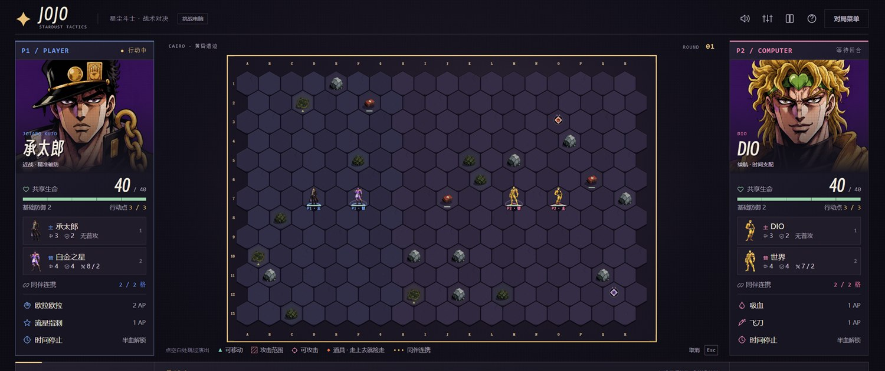
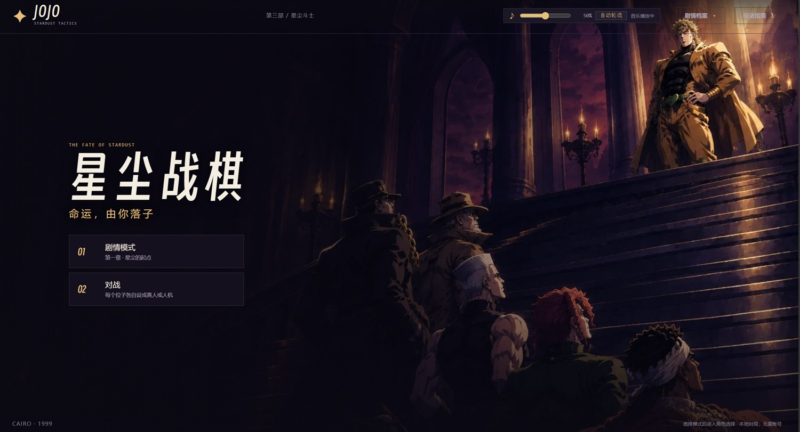

# JOJO 星尘战棋 · STARDUST TACTICS

一个用 Canvas 手写的**六边形战棋小游戏**，题材取自《JOJO 的奇妙冒险》第三部。
**纯原生 JavaScript（ES 模块 + Canvas），没有框架、没有构建步骤**——打开 `index.html` 就能跑。

> **在线玩**：https://ppppx905.github.io/jojo-tactics/（同样内容的旧地址：https://ppppx905.github.io/jojo/）
>
> 想离线留一份：`jojo-standalone.html`（约 1 MB）把代码合并成一个文件，**和 `assets/` 文件夹放在一起**后双击即玩（`index.html` 走的是浏览器模块加载，直接双击会被浏览器的 file:// 限制拦住）。



*实机画面：18×13 的六边形棋盘、地形、双方本体与替身，右下是技能栏*



*标题界面*

---

## 一眼看懂它在做什么

- **六边形棋盘** 18 列 × 13 行（234 格），每格有地形：岩石（挡路、相邻 +1 防御）、草丛（+3 防御）、恢复点（+10 生命）、毒沼（−3 生命）
- **双方各自一枚「本体」+ 一枚「替身」**：本体与替身共享一条生命，距离太远会互相削弱；替身被打掉比本体更疼
- **地形上还会刷新可拾取道具**：力量（攻击 +2）、护盾（防御 +1）、疾风（移动 +1）、时间（当场 +1 行动点）、连携（连携距离 +1）——走上去就捡走
- **8 章剧情模式**：每一章有专属机制与两段式剧情演出（例如"对手顶着同伴的脸混进来，打到半血才露出本体"）
- **对战模式支持 2v2，并且每个位子可以单独设成真人或电脑**（1 个人也能凑满一桌，或者四个人同屏打）

## 怎么玩

| 操作 | 说明 |
|---|---|
| 鼠标点棋子 → 点落点 | 移动（1 行动点） |
| 点敌人 | 攻击（1 行动点） |
| `Q` `W` `E` | 三个技能（各自的消耗与冷却见按钮） |
| `Space` | 结束回合 |
| 点空白处 | 跳过演出（台词 / 横幅 / 提示） |

每回合 3 点行动点。移动、普攻、技能都从这里扣。

## 怎么验证它是对的

```bash
node --test --experimental-test-isolation=none tests/*.test.js
```

**471 条断言 / 47 个测试文件全绿**。测试覆盖的不只是数值，还包括：

- **规则不变式**：任意两个角色对战都能收敛出胜负（不会被 AI 拖成死循环）
- **章节隔离**：某一章的机制（反光点、冷枪、船体要害）绝不会泄漏到别的章节
- **随机一致性**：地图地形用固定随机序列重放，逐格比对，确认改动没有偷偷动到老地图
- **界面契约**：选人开关、技能栏、状态标签、棋盘标记都有 fake-DOM 级别的断言

素材完整性检查（缺图会报出来，避免线上出现占位图形）：

```bash
node tools/check-assets.mjs     # 15 个角色 / 70 项素材引用 / 0 缺失
node tools/check-html.mjs       # HTML 结构与 id 契约
```

## 仓库结构

```
index.html            入口（也是可玩的页面；无构建步骤）
src/core/             纯规则引擎：hex 坐标、游戏状态机、数值表、AI 决策
src/ui/               渲染与界面：Canvas 绘制、HUD、剧情演出、音效
tests/                471 条断言（node:test，无需任何依赖）
tools/                自己写的小工具：静态服务器、打包、素材处理、素材检查
assets/               游戏运行时读取的素材（立绘/肖像/插画/地形/场地/音乐）
docs/                 设计文档、交接文档与美术提示词
jojo-standalone.html  代码合并成一个文件的版本（双击即玩，但需与 assets/ 同目录）
使用说明.txt          给玩家看的说明（怎么开始 / 怎么操作 / 手机上怎么玩）
```

引擎（`src/core/`）不碰 DOM、不碰计时器、不碰音频——所以规则可以在 Node 里被完整测试，
这也是这个项目能靠测试守住 8 章机制的原因。

## 已知的不足

- AI 对手是**规则评分式**决策（走位打分、拉开距离、权衡换血），**不是强化学习**；它在"该不该抢道具""要不要为射程绕路"这类局面仍然偏保守
- 棋盘格子数多，**窄屏（手机）下棋子偏小**，目前没有做"保底格宽 + 横向滚动"
- 地图目前只有两张（默认战场 / 浅滩水路），地形布局与道具配置都是数据驱动的，加新地图只需要写一条数据
- 有一张素材（替身「吊死者」的立绘）是最后补齐的，成品美术风格在几个旧章节之间略有差异

## 开发方式（说明一下，因为招聘公告里提到会观察这一点）

这个项目是**人机协作**做出来的，分工是明确的：

- **人（我）负责**：决定做什么、数值与手感拍板、每一轮的验收与退回、以及"这个方向对不对"的判断
- **AI（DeepSeek Harness 的编程 agent）负责**：写代码、跑测试、查资料、生成美术素材、清理与重构
- 流程上刻意做了三件事，防止"AI 大量产出但没人负责"：
  1. **先方案后动手**——任何数值或机制改动都先出方案，由人点头才写
  2. **每一轮都跑全量测试**，并且把"改动前后行为是否一致"写成断言
  3. **留一份交接文档**（`docs/开发交接文档.md`），记录每一处改动**为什么**这么改、哪些方案被退回、踩过哪些坑

美术素材是用图像生成模型做的（提示词全部保留在 `docs/prompts/` 里，可以看到从"第一版被退回"到"定稿"的迭代过程）。

这个仓库是**整理后的发布版本**：游戏本体、测试、工具、素材和文档都在，开发过程中的临时文件、评审用的美术原稿、打包中间产物没有放进来。想看某一块的来龙去脉，`docs/开发交接文档.md` 里按时间写得很细。

## 声明

非商业同人作品，仅供学习交流。《JOJO 的奇妙冒险》及其角色版权属于原作者荒木飞吕彦与集英社。
